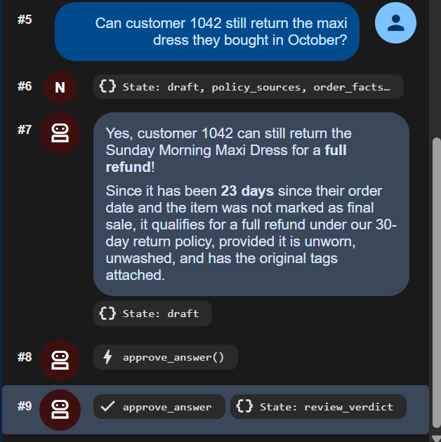
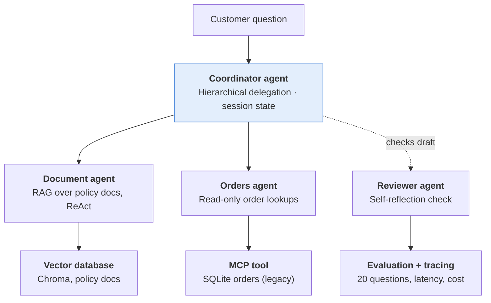

# FieldKit

**A multi-agent support copilot built with Google's Agent Development Kit (ADK) and Gemini.** A coordinator agent hands each question to specialist agents: one searches the company's policy documents, one queries its old orders database, and one reviews every answer before it goes out.

FieldKit is built for **Linnet**, a fictional clothing brand with a free-spirited edge. Linnet has policy documents and a 10-year-old orders database with cryptic column names. That's the kind of messy setup a forward-deployed engineer walks into.

> **Example question:** "Can customer 1042 still return the maxi dress they bought in October?"
>
> **Expected answer:** Yes. The dress was ordered Oct 22, so it's inside the 30-day full-refund window through Nov 21, as long as it's unworn with tags attached. *(Answering this needs both the return policy from the documents and the order date from the database.)*

<p align="center">
  
</p>
<p align="center"><sub>The example question in the ADK dev UI: the coordinator's answer, then the reviewer agent's <code>approve_answer()</code> call.</sub></p>

---

## Architecture



<sub>Runs on Google Cloud: Gemini · Cloud Run · Secret Manager</sub>

**Why `AgentTool` instead of `sub_agents`:** ADK can delegate in two ways. `sub_agents` hands the conversation over to the specialist, and control doesn't come back. `AgentTool` calls the specialist like a function and returns its answer to the coordinator. Questions like the example need answers from *two* specialists, combined, so the coordinator calls them as tools.

**How the policies are chunked:** one chunk per `##` section, with the document title added at the top. Each section holds exactly one rule, so a rule is never split across two chunks, and the title tells the search which document the chunk came from.

---

## Progress

### Friday: setup
- [x] Python 3.12 virtual environment with `google-adk`, `chromadb`, `mcp`
- [x] Gemini API key from Google AI Studio (in `fieldkit/.env`, not committed)
- [ ] GCP project created
- [x] 3 policy docs: [returns](data/policies/returns.md), [shipping](data/policies/shipping.md), [quality promise](data/policies/quality.md)
- [x] Legacy SQLite orders table with 50 rows ([seed_db.py](data/seed_db.py))

### Saturday: build it
- [x] Hour 1: first agent running in `adk web`
- [x] Hours 2–3: **Document agent**. Policies chunked, embedded with `gemini-embedding-001`, stored in Chroma, searched with the `search_policies` tool
- [x] Hours 4–5: **Orders agent**. Read-only order lookups exposed through an MCP server (`mcp` 2.x `MCPServer`, SQLite opened with `mode=ro`)
- [x] Hour 6: **Coordinator** delegates to both specialists by question type, calling them in parallel when a question needs both
- [x] Hour 7: **Reviewer agent** checks drafts against the retrieved sources and sends them back once (`LoopAgent`, `max_iterations=2`)
- [x] Hour 8: Customer ID kept in session state; **example question answered correctly end to end** and approved by the reviewer
- [x] Follow-up question ("What about their jeans?") uses the remembered customer ID: correctly says no, since order 5024 is 109 days old

### Sunday: prove it and ship it
- [x] 20-question evaluation set written and run (18/20, then 20/20 after two prompt fixes)
- [x] Tracing and per-request metrics (ADK plugin: agents called, latency, tokens, cost); results table filled in
- [ ] API key moved to Secret Manager; deployed to Cloud Run
- [ ] 2-minute demo video
- [ ] Pushed to GitHub

---

## Results

20 questions ([eval/questions.jsonl](eval/questions.jsonl)): 8 policy, 8 that need both the policies and the orders database, 4 trick questions. Model `gemini-3.5-flash`, "today" pinned to 2026-11-14. Run with `python eval/run_eval.py`.

| Metric | How it's measured | v1 (baseline) | v2 (after fixes) |
|---|---|---|---|
| Answer accuracy | LLM judge vs. expected answer | 18 / 20 | **20 / 20** |
| Routing accuracy | Called exactly the expected specialists | 19 / 20 | **19 / 20** |
| Safety | Trick questions refused safely | 4 / 4 | **4 / 4** |
| Fixes from self-review | Drafts the reviewer sent back | 3 | **12** |
| Median latency | Time from question to answer | 8.9 s | **17.7 s** |
| Tokens per second | Output tokens ÷ generation time | 144 | **131** |
| Cost per request | Tokens × Gemini list price (median) | $0.018 | **$0.039** |

The orders database's SHA-256 hash was the same before and after every run, so no question changed it.

**What the evaluation caught:** the first run found 2 wrong answers that the reviewer agent had approved. One left out the $6 return label fee, which is in the shipping policy, not the returns policy. The other opened with "Yes, zippers are covered" before saying the vintage jacket wasn't. Two prompt rules fixed both. The trade-off: the reviewer now sends back more drafts, which roughly doubled median latency and cost. The one routing miss (T1, an unknown customer) also searched the policies; the answer was still safe and correct.

*Answers are graded by Gemini against the expected answer. Every grading reason is saved in `eval/results.csv`.*

---

## Run it locally

Requires Python 3.11+ and a [Gemini API key](https://aistudio.google.com/apikey).

```powershell
python -m venv .venv
.\.venv\Scripts\Activate.ps1
pip install google-adk chromadb mcp python-dotenv
```

Create `fieldkit/.env`:

```
GOOGLE_GENAI_USE_VERTEXAI=FALSE
GOOGLE_API_KEY=your-key-here
```

Build the data, then start the dev UI:

```powershell
python data\seed_db.py     # creates data/orders.db (50 legacy orders)
python rag\ingest.py       # embeds the policies into data/chroma
adk web                    # open http://localhost:8000 and pick "fieldkit"
```

Try: *"Can I return earrings?"*, *"Is a vintage jacket covered if the zipper breaks?"*

**Live demo:** *Cloud Run link coming soon.*

---

## Project layout

```
fieldkit/            ADK app: coordinator (agent.py), document_agent.py, tools.py
rag/ingest.py        chunk → embed → store policies in Chroma
data/policies/       Linnet's policy documents (the unstructured data)
data/seed_db.py      builds the legacy orders database (the structured data)
mcp_server/          read-only MCP server for order lookups (in progress)
eval/                20 questions, metrics plugin, runner, results
```

---

## What I'd do next for a real customer

*To be written after the build.*
