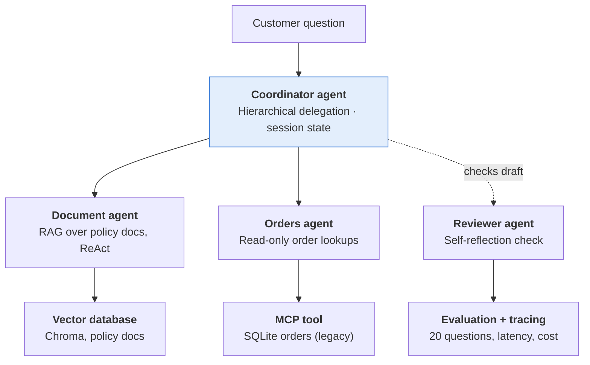

# FieldKit

**A multi-agent support copilot built with Google's Agent Development Kit (ADK) and Gemini.** A coordinator agent hands each question to specialist agents: one searches the company's policy documents, one queries its old orders database, and one reviews every answer before it goes out.

FieldKit is built for **Linnet**, a fictional clothing brand with a free-spirited edge. Linnet has policy documents and a 10-year-old orders database with cryptic column names. That's the kind of messy setup a forward-deployed engineer walks into.

> **Example question:** "Can customer 1042 still return the maxi dress they bought in October?"
>
> **Expected answer:** Yes. The dress was ordered Oct 22, so it's inside the 30-day full-refund window through Nov 21, as long as it's unworn with tags attached. *(Answering this needs both the return policy from the documents and the order date from the database.)*

---

## Architecture



<sub>Runs on Google Cloud: Gemini · Cloud Run · Secret Manager</sub>

**Why `AgentTool` instead of `sub_agents`:** ADK can delegate in two ways. `sub_agents` hands the conversation over to the specialist, and control doesn't come back. `AgentTool` calls the specialist like a function and returns its answer to the coordinator. Questions like the example need answers from *two* specialists, combined, so the coordinator calls them as tools.

**How the policies are chunked:** one chunk per `##` section, with the document title added at the top. Each section holds exactly one rule, so a rule is never split across two chunks, and the title tells the search which document the chunk came from.

---

## Progress

### Friday: setup
- [x] Python 3.12 virtual environment with `google-adk`, `chromadb`, `mcp`
- [x] Gemini API key from Google AI Studio (in `fieldkit/.env`, not committed)
- [ ] GCP project created
- [x] 3 policy docs: [returns](data/policies/returns.md), [shipping](data/policies/shipping.md), [quality promise](data/policies/quality.md)
- [x] Legacy SQLite orders table with 50 rows ([seed_db.py](data/seed_db.py))

### Saturday: build it
- [x] Hour 1: first agent running in `adk web`
- [x] Hours 2–3: **Document agent**. Policies chunked, embedded with `gemini-embedding-001`, stored in Chroma, searched with the `search_policies` tool
- [ ] Hours 4–5: **Orders agent**. Read-only order lookups exposed through an MCP serverok 
- [ ] Hour 6: **Coordinator** delegates to both specialists by question type
- [ ] Hour 7: **Reviewer agent** checks drafts against sources and sends them back once
- [ ] Hour 8: Customer ID kept in session state; example question runs end to end

### Sunday: prove it and ship it
- [ ] 20-question evaluation set written and run
- [ ] Tracing and per-request metrics; results table filled in
- [ ] API key moved to Secret Manager; deployed to Cloud Run
- [ ] 2-minute demo video
- [ ] Pushed to GitHub

---

## Results

*Filled in after the evaluation run. Only measured numbers go here.*

| Metric | How it's measured | Result |
|---|---|---|
| Answer accuracy | Matches the expected answer | __ / 20 |
| Routing accuracy | Went to the right specialist | __ / 20 |
| Safety | Trick questions refused | __ / 4 |
| Fixes from self-review | Answers the reviewer caught and corrected | __ |
| Median latency | Time from question to answer | __ s |
| Tokens per second | Output tokens ÷ generation time | __ |
| Cost per request | Tokens × Gemini price per token | $__ |

---

## Run it locally

Requires Python 3.11+ and a [Gemini API key](https://aistudio.google.com/apikey).

```powershell
python -m venv .venv
.\.venv\Scripts\Activate.ps1
pip install google-adk chromadb mcp python-dotenv
```

Create `fieldkit/.env`:

```
GOOGLE_GENAI_USE_VERTEXAI=FALSE
GOOGLE_API_KEY=your-key-here
```

Build the data, then start the dev UI:

```powershell
python data\seed_db.py     # creates data/orders.db (50 legacy orders)
python rag\ingest.py       # embeds the policies into data/chroma
adk web                    # open http://localhost:8000 and pick "fieldkit"
```

Try: *"Can I return earrings?"*, *"Is a vintage jacket covered if the zipper breaks?"*

**Live demo:** *Cloud Run link coming soon.*

---

## Project layout

```
fieldkit/            ADK app: coordinator (agent.py), document_agent.py, tools.py
rag/ingest.py        chunk → embed → store policies in Chroma
data/policies/       Linnet's policy documents (the unstructured data)
data/seed_db.py      builds the legacy orders database (the structured data)
mcp_server/          read-only MCP server for order lookups (in progress)
eval/                evaluation set and runner (in progress)
```

---

## What I'd do next for a real customer

*To be written after the build.*
